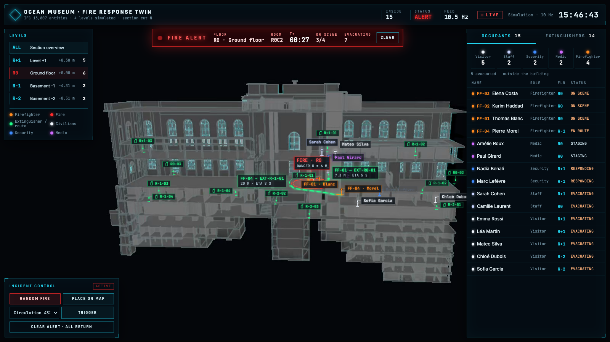
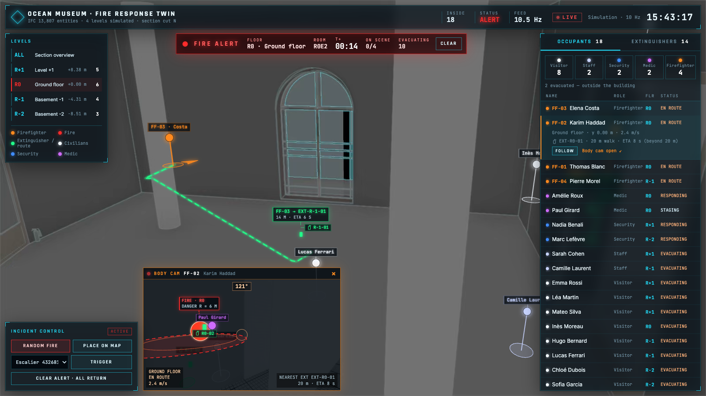
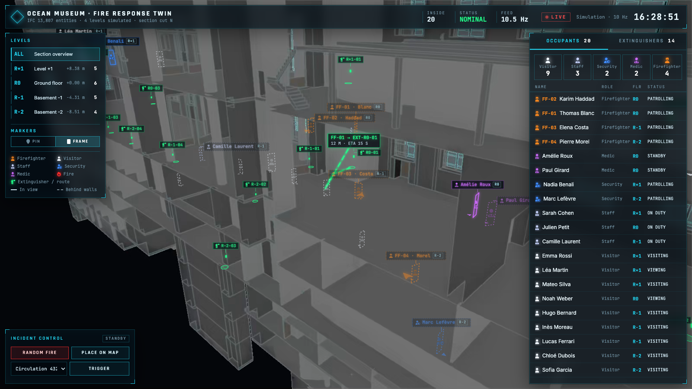

# Ocean Museum · Fire Response Twin

A real-time digital twin of the Ocean Museum, built with [3dverse](https://docs.3dverse.com) and React. Simulated occupants walk through the real building (an IFC model cut in section) on four levels. An operator can raise a fire alert, watch firefighters respond, open their body cams, and see each firefighter's walking route to the nearest extinguisher.



## Run it

```sh
cp .npmrc.example .npmrc   # then put your Font Awesome Pro npm token in it
npm install
npm run dev                # http://localhost:5173
```

The HUD and the markers use Font Awesome Pro icons (`@fortawesome/pro-solid-svg-icons`), installed from the Font Awesome registry, which needs a token. `.npmrc` is git-ignored: never commit the token.

The app opens its own transient 3dverse session on the museum scene (scene id and public token in [`src/config.ts`](src/config.ts)).

| URL parameter | Effect |
|---|---|
| *(none)* | Simulated feed, seed 7 |
| `?seed=42` | Simulated feed with another random seed (replayable) |
| `?feed=wss://host/path` | Live feed over WebSocket instead of the simulation (see [Plug in real data](#plug-in-real-data)) |

Other scripts: `npm run build`, `npm run lint`, and `npm run extract` / `npm run extract:refresh` to regenerate the building data (see [The building data](#the-building-data)).

### Using the twin

- **Levels** (top left): one floor per button, with its height and how many people are on it. Clicking a level **isolates** it: the camera looks at that floor through the cut, and people, routes and extinguishers of the other floors fade out. Click it again, or **ALL**, to see every floor.
- **Markers** (same panel): **PIN** draws each person as a halo, a stem and a head. **FRAME** draws an upright rectangle that faces where the person walks, with their role icon inside. The rectangle turns with them: it gets narrower as they turn sideways, and a tick on the floor marks their front. The choice is remembered in this browser.
- **Solid or dashed**: a person drawn solid is in direct view of the camera. A dashed, faded marker (and dimmed label) means walls or floors hide them, and the overlay shows them through the building. Their labels give way to people in view.
- **Occupants** (right): everyone inside the building, with a count per role. Click a role to filter. Each row shows name, role, floor and status. Clicking a row flies the camera to that person, highlights them, and shows their details, with a **FOLLOW** button.
- **Incident control** (bottom left): start a fire with **RANDOM FIRE**, pick a room and press **TRIGGER**, or press **PLACE ON MAP** and click in the 3D view. The alert banner shows floor, room, time since the alert, firefighters on scene and people evacuating. **CLEAR** ends the alert.
- **Body cam**: selecting a firefighter (in the list or on their label) opens their live point of view in a picture-in-picture window. It shows heading, floor, status and the route to their nearest extinguisher.





Colour code, used in 3D and in the UI: firefighters **orange**, fire **red**, extinguishers and routes **green**, civilians **white**, security **blue**, medics **violet**. Role icons: visitor, staff (tie), security (shield), medic (doctor), firefighter (safety helmet).

## How it is built

```
scripts/extract-building.mjs   scene description (IFC) → src/building/museum.generated.json
src/
  building/      typed access to the extracted geometry: floors, rooms, nav grids, nodes
  pathfinding/   waypoint graph, A* and Dijkstra, nearest-extinguisher routes
  simulation/    PeopleFeed interface, simulated feed, WebSocket feed, roster
  state/         store (shared by UI and 3D) and user actions
  twin3d/        DigitalTwin entities, body cams, camera moves, projected overlay
  ui/            HUD panels (top bar, alert, people/extinguishers, incident, PiP)
```

Data flow:

```
PeopleFeed ──10 Hz──▶ store ──▶ RouteTracker (Dijkstra to the nearest extinguisher)
 (simulation or live)   │  ├──▶ TwinRenderer: DigitalTwin entities (30 Hz, interpolated), body cams
                        │  ├──▶ TwinOverlay: markers, danger radius, routes, labels (every frame)
                        │  └──▶ UI panels
          fire alert ◀──┘  (the store tells the feed about the incident; the simulation reacts)
```

The simulation, the pathfinding and the UI are separate modules. The UI and the 3D layer only depend on the types in [`src/simulation/types.ts`](src/simulation/types.ts).

## The building data

Every position comes from the scene. Nothing is hand-placed. [`scripts/extract-building.mjs`](scripts/extract-building.mjs) reads the scene description (13,807 entities converted from IFC), computes the world transform and bounding box of every element, and writes `src/building/museum.generated.json`:

- **Levels.** The four simulated levels are two above ground and two basements. Each walking height is the most common floor height of its rooms:

  | Level | Storey | Y (m) |
  |---|---|---|
  | R+1 | Niveau R+1 | 8.38 |
  | R0 | Niveau R-0 | 0.00 |
  | R-1 | Niveau R-1 | −4.31 |
  | R-2 | Niveau R-2 | −8.51 |

- **Walkable area, per level, on a 0.25 m grid.** The grid starts from the rooms (`IfcSpace`), excluding voids, lift shafts, closets and pools. Walls, columns and railings are removed where they cross body height. Door openings are carved back through the whole wall thickness. Stair flights and landings at that level are removed too. Finally the area is eroded by the body radius (0.25 m).
- **Waypoint graph.** The graph has 405 nodes: rooms and corridors (one node every ~6 m), doors, stair waypoints and extinguisher access points. Two nodes of the same level are linked only if the straight line between them stays on walkable cells, so paths never cross a wall.
- **Stairs.** Four stairs link the levels. Each is built as a 3D chain from its `IfcStairFlight` and landing (`IfcSlab`) bounding boxes:
  - **Stair tower** (R0 ↔ R+1): three switchback stairs.
  - **Central stairs west and east** (R-1 ↔ R0).
  - **East service stair** (R-2 ↔ R-1).

  Levels are joined only through these chains, so nobody passes through a slab.
- **Extinguishers.** There are 14: 3 or 4 per level, next to stair exits, at corridor ends and next to exterior doors, each hung on the nearest wall.
- **Exits.** There are 6: ground-floor doors with a room on one side only.
- **Occluders.** There are 1,329 boxes that can hide a person from a camera: walls, columns, slabs, roofs and ceilings, clipped to the section box. Doors, windows and the measured arch are stored as openings in their wall.

Run `npm run extract:refresh` after the scene changes, for example when the section box is moved: it downloads the scene description again. `--debug-svg <dir>` also writes one floor plan per level.

Assumptions, stated in the script:

- **Stair direction.** Which end of a flight is the bottom is read from its landing, or from the stair spaces at each level when the stair is a single mesh.
- **Measured opening.** One opening is part of a wall's own mesh, with no `IfcOpeningElement`: the 3.1 m arch between the R-1 stair hall and the Grand Bassin hall. It was measured on the rendered scene with screen-space ray casts (`MEASURED_PASSAGES`).
- **Glass openings.** Glazed openings that reach the floor and are at least 2 m tall are treated as glass doors.

## How the simulation works

[`SimulatedPeopleFeed`](src/simulation/SimulatedPeopleFeed.ts) has 20 agents (fictional names):

| Role | Count | Walking speed (m/s) |
|---|---|---|
| Visitor | 9 | 0.85–1.25 |
| Staff | 3 | 1.2–1.4 |
| Security | 2 | 1.3–1.45 |
| Medic | 2 | 1.3–1.45 |
| Firefighter | 4 | 1.25–1.4 |

- **Walking.** Each agent picks a destination, mostly inside the visible section. It then follows the A* path over the waypoint graph: corridors, doors and stairs, where it walks at 60 % speed. It stops for a few seconds and picks another. Responders jog at 2.4 m/s.
- **Publishing.** Every tick (10 Hz) the feed publishes one snapshot of everyone (`id, name, role, floorId, position, heading, speed, status, inside`). Between snapshots, positions are interpolated for display.
- **Fire alert.** When a fire starts:
  - visitors and staff evacuate to the nearest exit and leave the building
  - security holds a cordon just outside the danger radius
  - medics stage at the exit closest to the fire
  - firefighters jog to the fire and stop 2 m short of it (`en route` → `on scene`)
- **Clear.** When the alert is cleared, firefighters return to their posts and evacuees come back in.

**Routes to extinguishers.** For each firefighter, [`RouteTracker`](src/pathfinding/routes.ts) runs Dijkstra from their position to every extinguisher's access node. It runs whenever the firefighter has moved 0.75 m, or at least once a second. The result is the nearest extinguisher by walking distance, stairs included. If it is 20 m away or less, the route is drawn as an animated glowing line on the floor, with its distance and an ETA (distance ÷ current speed, 1.4 m/s when standing).

## Plug in real data

The app only talks to the [`PeopleFeed`](src/simulation/types.ts) interface:

```ts
interface PeopleFeed {
    readonly kind: "simulation" | "live";
    readonly label: string;
    connect(): void;
    disconnect(): void;
    subscribe(listener: (snapshot: PeopleSnapshot) => void): () => void; // ≥ 5 snapshots/s
    onStatus(listener: (status: "connecting" | "live" | "offline") => void): () => void;
    setIncident?(incident: FireIncident | null): void; // the app reports alerts to the feed
}
```

To use a real source, implement this interface and return it from [`createFeed`](src/simulation/createFeed.ts). Nothing in the UI or the 3D layer changes.

**WebSocket.** [`WebSocketPeopleFeed`](src/simulation/WebSocketPeopleFeed.ts) is ready to use with `?feed=wss://…`. It reconnects on its own and forwards fire alerts to the server. It accepts:

```json
{ "type": "snapshot", "timestamp": 1732100000000,
  "people": [ { "id": "badge-17", "name": "A. Visitor", "role": "visitor",
                "floorId": "R0", "position": [52.1, 0.0, 4.3], "heading": 1.57,
                "status": "visiting" } ] }

{ "type": "person", "person": { "id": "badge-17", "position": [52.4, 0.0, 4.1] } }
```

`role` is one of `visitor | staff | security | medic | firefighter`. `floorId` is one of `R+1 | R0 | R-1 | R-2`. If `floorId` is missing, it is deduced from the height.

**Coordinates.** Positions are in scene coordinates: metres, Y up, the same frame as the IFC model. If your positioning system gives floor-plan coordinates, convert them on the server or override `toScene()`. Noisy positions are snapped back onto the walkable grid before routing.

**MQTT.** Use a broker with WebSockets (e.g. `mqtt.js`). Subscribe to your position topic, keep a `Map` of people, and call the listeners with a snapshot at 5–10 Hz. It is the same pattern as `WebSocketPeopleFeed`, in about forty lines.

**Indoor positioning (BLE / UWB).** Have a small service publish badge positions in one of the formats above. Badge IDs map to `id`; role and name come from your staff and visitor registry.

## Rendering choices

- **The building is never modified.** The look comes from the operator camera only: no background, cyan edge outlines, darkened image, bloom on what glows. Everything the app adds lives under one root entity, **`DigitalTwin`**. That includes one moving entity per person, the body-cam cameras, extinguisher anchors, the fire with its red light, and the operator camera. All of them are transient (session only) and deleted when the browser disconnects.
- **Markers are a projected overlay.** People (pin or frame, heading arrow for firefighters), the danger radius, extinguishers and routes are drawn as SVG and labels. They are projected through each viewport's camera every frame, in the main view and in the body cams. The app's public token cannot read any mesh asset, so it cannot place geometry in the scene. The overlay also gives the x-ray effect: people stay visible through walls and behind the section. Labels are placed by priority (selected person, fire, routes, firefighters, others) and never overlap; a label without room shrinks to its dot.
- **Occlusion.** Because the overlay is drawn on top, it decides itself who is hidden. For each person, [`occlusion.ts`](src/twin3d/occlusion.ts) tests the lines from the camera to their head and chest against the occluder boxes. A line that crosses a wall through one of its openings is not blocked. This runs every third frame (about 5 µs per test) and uses the body cam's own position in the picture-in-picture. A person's state flips only after three identical answers in a row, so markers don't flicker on edges. Limits:
  - Diagonal walls are not occluders.
  - Glass curtain walls, furniture and stairs are not occluders.
  - A stair opening in a slab still counts as solid.
- **Section and body cams.** The scene's culling box hides everything outside the section, for every camera. When a firefighter is outside the section, the body cam shows a floor grid at their level, plus the overlay, and says so.

## Technologies

[3dverse Livelink](https://docs.3dverse.com/references/livelink.react) (React) · React 19 · TypeScript · Vite · Tailwind CSS v4
